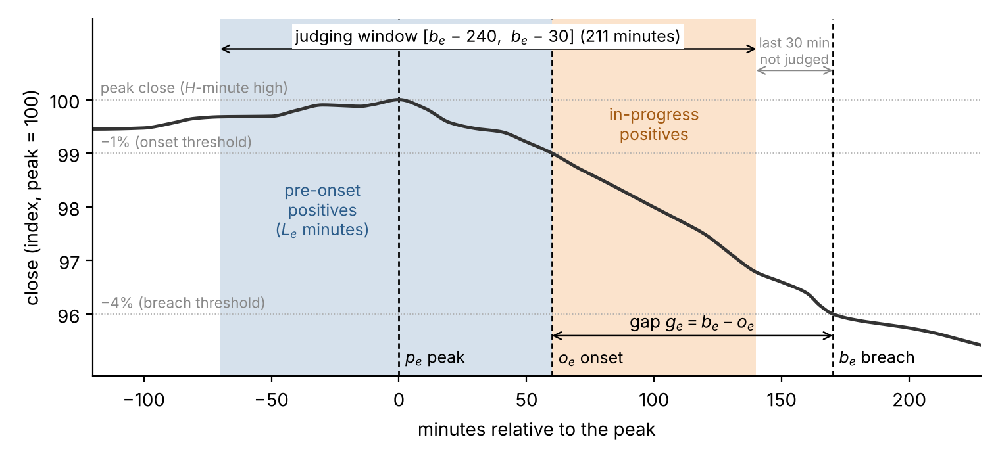
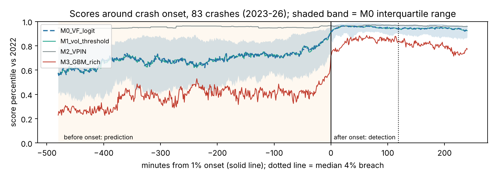

# How Much of Crash Early Warning Is Early?

Replication materials for Shin, Y. K. *How Much of Crash Early Warning Is Early? Separating Pre-Onset Warning from In-Progress Detection.* Manuscript submitted for publication.

[](https://doi.org/10.17605/OSF.IO/TB245)
[](https://doi.org/10.17605/OSF.IO/BKJUQ)
[](LICENSE)


## The question

A crash-warning model scores every minute. The usual evaluation labels a minute positive if a crash follows 30–240 minutes later, even when the price is already falling, so a model can score well by recognizing crashes that have already begun. I split ROC-AUC exactly into a pre-onset part (warning before the decline starts) and an in-progress part (detecting a decline already under way).



*Figure 1 (schematic). The breach is the first close 4% below the high of the previous 4 hours, and the onset is the first close 1% below that peak. The positives are the minutes 30–240 before the breach (the judging window), split at the onset into pre-onset and in-progress minutes. I drew the figure with `scripts/fig1_schematic.py`.*

## Contents

| Item | Location |
|---|---|
| Notebook or script behind the sections, tables and figures of the paper | [`docs/NOTEBOOKS.md`](docs/NOTEBOOKS.md) |
| Code of the programming sample and its runnable cells | [`programming_sample/`](programming_sample/) |
| AUC decomposition (main result) | [notebook 18](notebooks/18_BTC_Standard_Protocol_Inflation_SPOT.ipynb) |
| Exact conditional null for budget-constrained alerts | [notebook 34](notebooks/34_Exact_Conditional_Null_Budget_Audit_SPOT_PREFLIGHT_v2.ipynb) |
| Preregistered prospective test (from December 2026) | [notebook 31](notebooks/31_Prospective_Test_Frozen_Systems_Dec2026_start.ipynb) |
| Notebook behind each results folder | [`results/README.md`](results/README.md) |
| Checks that need no data download | [Quick check](#quick-check-without-downloading-data) |

## Main results

Most measured skill is detection: 62% of M0's AUC above 0.5 comes from minutes after the fall began. M0 warns before onset more often than chance in the development period (22 of 83 crashes, against 6.7 expected) but not in the one-shot 2018–2020 holdout (13 of 199, against 11.4 expected; p = 0.35).

A crash is a close 4% below the high of the previous 4 hours (Bitcoin, one-minute Binance spot data). I froze the definitions and thresholds of the four models in notebook 16:

- M0 (`M0_VF_logit`, "V+F"): logistic regression on a volatility z-score and the taker-sell share
- M1 (`M1_vol_threshold`): the volatility z-score alone
- M2 (`M2_VPIN`): VPIN, the volume-synchronized probability of informed trading
- M3 (`M3_GBM_rich`, "GBM"): gradient boosting on 17 features

| Result for M0 | Value | Source |
|---|---|---|
| **Development period, January 2023 to April 2026, 83 crashes** | | |
| AUC, standard labeling | 0.76 | notebook 18 |
| AUC, pre-onset positives only | 0.67 | notebook 18 |
| AUC, pre-onset positives within volatility deciles | 0.59 | notebook 18 |
| Positive minutes already inside a decline | 41% | notebook 18 |
| Share of the AUC above 0.5 from those minutes | 62% | notebook 18 |
| Crashes warned before onset by 800 alerts (chance: 6.7) | 22 of 83 (p = 7.4 × 10⁻⁸) | notebook 34 |
| **One-shot holdout, Bitcoin 2018 to 2020, 199 crashes, 713 alerts** | | |
| Crashes warned before onset (chance: 11.4) | 13 of 199 (p = 0.35) | notebooks 11, 12 |
| Crashes caught after onset (chance: 7.7) | 23 of 199 (p < 0.001) | notebooks 11, 12 |
| **Ten equity indices, daily 2005 to 2025, 10% crashes, preregistered** | | |
| Share of the AUC above 0.5 from days already in a decline | 81% (95% interval 69–95%) | notebook 38 |

Chance is the expected count when I place the alerts at random within month × volatility decile (development period) or shift them in time (holdout).



*Median score percentile of the four models around the onset of the 83 crashes; the shaded band is M0's interquartile range. I drew it with `programming_sample/nb18_scores_around_onset.py` from the stored results of notebook 18.*

## Quick check without downloading data

From the repository root:

```
pip install -r requirements-check.txt
sha256sum -c MANIFEST.sha256                   # every file matches its recorded hash
python scripts/appH_toy_checks.py              # 81 of 81 checks match
python scripts/nb39_construction_checks.py     # 86 of 86 construction checks match
python scripts/altcoin_effect_size.py          # 33 of 33 values match the text
python scripts/loco44_summary.py               # 32 of 32 cells match Table B.19
python programming_sample/nb34_m0_exact_null.py
```

Each script takes a few seconds. I reran them on 10 November 2026 with Python 3.13 and the versions pinned in `requirements-check.txt`; every check matched, and `nb34_m0_exact_null.py` reproduced its stored output in `programming_sample/output/`. The notebooks need the data downloads described under [Data](#data).

## Layout

The repository holds the analysis notebooks, frozen model files, specification files, stored result tables and a SHA-256 manifest.

| Path | Contents |
|---|---|
| `notebooks/` | 54 Colab notebooks: 01–51, with 30 split into 30a and 30b, plus 29b and 38b. Most are saved with their outputs; notebooks 15 and 16 keep the outputs of only a few cells, and all their result files are in `results/`. `INDEX.csv` gives the results folder of each |
| `results/` | Stored outputs: result tables (CSV, JSON), frozen models (`.joblib`), specifications (`*_SPEC.json`), lock files and figures; [`results/README.md`](results/README.md) maps each folder to its notebook |
| `docs/NOTEBOOKS.md` | What each notebook does, where it writes and where the paper cites it, and the script behind each figure or table |
| `scripts/` | Stand-alone scripts behind the paper items listed in `docs/NOTEBOOKS.md` (Figures 1, 5 and B.1; Tables 7, 10, B.3, B.9 and B.19; checks for Sections 3.6, 8.2 and 9.4 and Appendices A and H); outputs in `scripts/output/` |
| `checks/half_month_null/` | Exact null with half-month cells, from stored files (Online Appendix I.7) |
| `programming_sample/` | Code of the two-page Python programming sample (excerpts of notebooks 18 and 34) and its three runnable cells |
| `requirements.txt`, `requirements-check.txt` | Packages the notebooks import; pinned versions for the quick check |
| `MANIFEST.sha256` | SHA-256 of every file in the repository |

## Data

All Bitcoin and altcoin results use Binance spot one-minute klines from the public archive at data.binance.vision. Notebook 01 downloads them, checks each archive against its published checksum and builds the cache that the later notebooks read; notebooks that need other periods or coins download them from the same archive in the same way. Some notebooks use further public sources: Binance USDⓈ-M futures klines (08, 11, 13, 25), futures metrics, funding rates and mark-price klines (21, 25), the Binance and Coinbase REST APIs (27), FRED, the Cboe VIX history and Yahoo Finance (29, 29b), the Kenneth R. French Data Library, FRED and Yahoo Finance (30a, 30b), and Yahoo Finance for ten equity indices (38).

Not included:

- the one-minute cache (`cache/`, `multicoin_shared_budget_v1/cache/`) and the raw equity-index downloads (`external_equity_indices_v1/raw/`);
- per-coin intermediate arrays built from exchange data: `HOLDOUT17_multicoin_2018_2019_v1/phase2/<coin>.npz` (10 files) and `altcoin_dev_period_v1/coins/<coin>_parts.npz` (10 files);
- `FINAL_frozen_policy_May_Sep_2026_v2_source_verified/archive_source/`.

The crypto event tables with `peak_close` and `breach_close` columns give the close at each event's peak and breach, and `RESEARCH_PACKAGE_v1/DATA_SOURCE_spot_cache.json` gives the close and volume of one minute as a fingerprint of the cache. `case_oct2026_v1/3_binance_vs_coinbase_spread.csv` gives, for 22–31 October 2026, the one-minute Binance–Coinbase spread and the Coinbase USDT-USD rate in basis points. No other data file holds prices. The equity-index outputs carry dates, positions, counts and statistics only.

### Data sources and license

- Binance Vision, https://data.binance.vision: spot and USDⓈ-M futures klines, futures metrics, funding rates and mark-price klines, accessed October–November 2026. The datasets are licensed under CC BY-NC-SA 4.0. I attribute the values derived from them and stored here (event closes, the cache fingerprint, the spread columns of the `case_oct2026_v1` spread file) to Binance Vision and share them under the same license.
- Binance and Coinbase Exchange REST APIs (notebook 27).
- FRED, Federal Reserve Bank of St. Louis: `VIXCLS`, `NASDAQCOM` (notebooks 29, 29b, and `VIXCLS` in 30a, 30b).
- Cboe Global Markets, `VIX_History.csv` (notebooks 29, 29b).
- Kenneth R. French Data Library: 48 Industry Portfolios (notebooks 30a, 30b).
- Yahoo Finance via `yfinance` (notebooks 29, 29b, 30a, 30b, 38); `results/external_equity_indices_v1/38_SPEC.json` lists the indices.

Apart from the Coinbase USDT-USD rate in the spread file, none of the Coinbase, FRED, Cboe, French or Yahoo series is stored here.

## Running the notebooks

I ran the notebooks on Google Colab with Google Drive mounted. They read and write `/content/drive/MyDrive/btc_lead_cost_results_77months_spot/`; `results/` is a copy of that folder without the items listed under Data, plus `results/README.md`. Notebook 01 writes its tables to the top level of the folder and every other notebook to a subfolder of its own, except 29 and 29b, which share one; `notebooks/INDEX.csv` lists the subfolder of each notebook.

To rerun them, copy `results/` to that Drive path or change the path variable in a notebook's first code cell. Notebook 01 builds the cache, and the later notebooks read frozen files written by earlier ones, in number order.

Some notebooks keep raw downloads in other Drive folders (`BTCUSDT_spot_holdout_2017_2020/`, `BTCUSDT_futures_holdout_2019_2020/`, `BTCUSDT_spot_2025_2026_case/`, `BTCUSDT_spot_prospective_2026_2027/`, `FRED_daily/`, `AUDIT_data/` and others under `MyDrive/`). I do not include them.

Notebooks 08, 11, 13 and 25 also read a one-minute USDⓈ-M futures cache from `MyDrive/btc_lead_cost_results_77months/cache/`, and notebook 13 also reads futures-data results of notebooks 02 and 05 from the same folder. I do not include that folder; the stored outputs of 08, 11, 13 and 25 are in `results/`.

The one-shot evaluations (11, 17, 38) refuse to run again once their lock file exists (`HOLDOUT_EVALUATED.lock`, `HOLDOUT17_EVALUATED.lock`, `EVALUATED.lock`). Each lock in `results/` records when I ran the evaluation and the hash of its specification, so a rerun needs a folder without the lock.

`requirements.txt` lists the packages the notebooks import. I saved the frozen models with scikit-learn 1.6.1; load them with that version. I did not record the versions of the other packages; the notebooks ran on the Colab CPU runtime of October and November 2026, with random seeds set in the code. The `.joblib` files are pickles, so load them only after checking their hashes against `MANIFEST.sha256`.

## Registered notebooks: 31 and 38

Notebook 31 runs the prospective test I registered on OSF Registries (https://doi.org/10.17605/OSF.IO/TB245). Its analysis code is in the notebook, and the registration records the SHA-256 of the `.ipynb` file:

`b2e30b56ce78d645af56091da2f9da42ea23ca5cd1bd5fa6f01e79f0b04b2eb7`

The registered file is the one in commit [`7c4862f`](https://github.com/ykshin-0831/crash-ews-preonset/commit/7c4862ff471308af2e70806427ede7fd31c2fee7). The file in `notebooks/` has the same analysis code; its markdown and printed messages are in English, while the registered file has them in Korean. This command recomputes the registered hash:

```
git show 7c4862f:notebooks/31_Prospective_Test_Frozen_Systems_Dec2026_start.ipynb | sha256sum
```

The notebook is in hash mode (`RUN_ANALYSIS = False`), and it is the only notebook that keeps its Colab run metadata. I will run the analysis once, after the evaluation period ends, with the registered file.

Notebook 38 runs the equity-index validation I registered at https://doi.org/10.17605/OSF.IO/BKJUQ. Its registered code is `results/external_equity_indices_v1/38_core.py`, whose SHA-256 is recorded in `38_SPEC.json`.

## Citation and license

Citation metadata is in `CITATION.cff`. All rights reserved (`LICENSE`): the files are here to view, download and run to reproduce the results of the article, and any other use requires my written permission. Values derived from Binance Vision datasets stay under CC BY-NC-SA 4.0 (details under [Data sources and license](#data-sources-and-license)).

Author: Yeong Kyeong Shin, Kyung Hee University, ORCID https://orcid.org/0009-0008-9079-6642.
